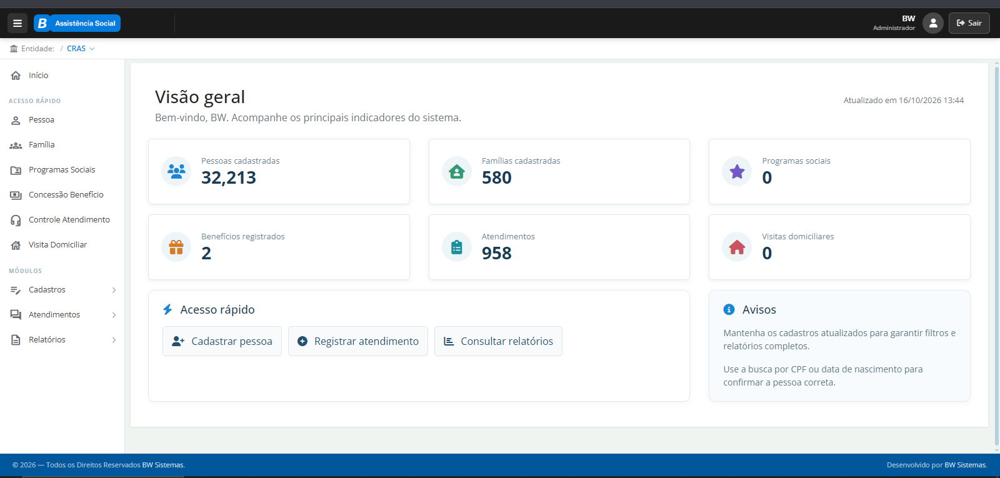
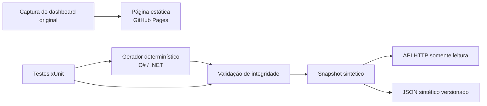

# BW Social — estudo de caso de portfólio

**Captura do dashboard original do sistema de assistência social e resumo da experiência profissional no produto.**

[](https://leandroavalle.github.io/socialweb-demo/)
[](https://github.com/LeandroAValle/socialweb-demo/actions/workflows/showcase.yml)



> A imagem é a captura do dashboard original fornecida para este estudo de caso. Os indicadores visíveis fazem parte da imagem. O link abre o [SocialWeb original](https://socialweb.bwinformatica.com.br/); esta página de portfólio é estática e não fornece acesso de demonstração nem conexão com o sistema.

## Em 30 segundos

O estudo de caso documenta a experiência profissional no desenvolvimento e na evolução de uma plataforma de gestão da assistência social. A página pública mostra uma captura do dashboard original e aponta para o sistema oficial. Em separado, o repositório mantém uma API independente de leitura com dados sintéticos, como material técnico explorável localmente; ela não replica nem se conecta ao produto original.

**O que este projeto demonstra:** modelagem de domínio, validação de integridade, agregação de indicadores, API HTTP, documentação técnica, testes e publicação automatizada.

## Explore

| Recurso | Acesso |
| --- | --- |
| Captura do dashboard e contexto do projeto | [Abrir estudo de caso](https://leandroavalle.github.io/socialweb-demo/) |
| Sistema original | [Abrir BW Social](https://socialweb.bwinformatica.com.br/) |
| API local | `dotnet run --project src/SocialWebDemo.Api` |
| Documentação técnica | [Arquitetura](docs/ARCHITECTURE.md) · [Decisões](docs/DECISIONS.md) · [Dados](docs/DATA.md) · [Segurança](docs/SECURITY.md) |

## Arquitetura



| Camada | Tecnologia | Papel |
| --- | --- | --- |
| Domínio | C# / .NET 10 | Entidades, geração sintética, regras e agregações |
| API | ASP.NET Core Minimal API | Consulta de contexto, indicadores e famílias |
| Página de portfólio | HTML e CSS | Captura do dashboard original e link para o sistema oficial |
| Qualidade | xUnit e GitHub Actions | Integridade, reconciliação e publicação |

O sistema profissional original foi desenvolvido em ASP.NET MVC/.NET Framework. A API técnica deste repositório é uma implementação independente em .NET 10; não é uma migração nem substituição do sistema original. A página publicada exibe somente a captura do dashboard e um link para o produto oficial.

## Execute localmente

Requisito: [.NET SDK 10](https://dotnet.microsoft.com/download/dotnet/10.0).

```bash
dotnet test SocialWebDemo.slnx -c Release
dotnet run --project src/SocialWebDemo.Api -- --export-snapshot
dotnet run --project src/SocialWebDemo.Api
```

Abra a URL exibida pelo ASP.NET Core e consulte, por exemplo:

```text
GET /health
GET /api/v1/context
GET /api/v1/overview
GET /api/v1/overview?territory=Território%20Aurora
GET /api/v1/households
GET /api/v1/households/FAM-0001
```

Para abrir a página de portfólio localmente, sirva a pasta `site/` por HTTP (por exemplo, `python -m http.server 8000 --directory site`) e acesse `http://localhost:8000`. A API e os dados sintéticos podem ser explorados separadamente pelos comandos acima.

## Decisões que importam

1. **Dados sintéticos por padrão.** A semente fixa torna a API de demonstração reproduzível e impede a exposição de cadastros reais.
2. **Indicadores calculados a partir dos registros.** Totais por território reconciliam com o consolidado. Qualidade cadastral é a razão entre famílias com cadastro completo e famílias selecionadas.
3. **API somente leitura.** O projeto explica consultas e regras sem simular alterações operacionais ou concessões reais.
4. **Captura original, sem reconstrução visual.** A página pública é uma vitrine estática do dashboard, sem imitar nem simular áreas do produto.
5. **Link direto para o produto oficial.** A interação com o sistema acontece no endereço original; a página do GitHub Pages não se conecta ao produto, à API ou a bases de produção.
6. **Escopo explícito.** Os números, faixas de renda e estados da API de demonstração são ilustrativos; não orientam elegibilidade, política pública ou decisões sobre pessoas.

Veja [as alternativas e consequências](docs/DECISIONS.md) e o [dicionário de dados](docs/DATA.md).

## Verificação

O workflow executa `dotnet test`, compila a API, gera novamente o snapshot e verifica se o arquivo versionado está sincronizado. Na branch `main`, publica `site/` no GitHub Pages. Os testes cobrem geração determinística, reconciliação territorial e rejeição de referências órfãs.

## Autor

**Leandro Valle** — desenvolvimento full stack, integrações e engenharia de dados. [Perfil GitHub](https://github.com/LeandroAValle).
