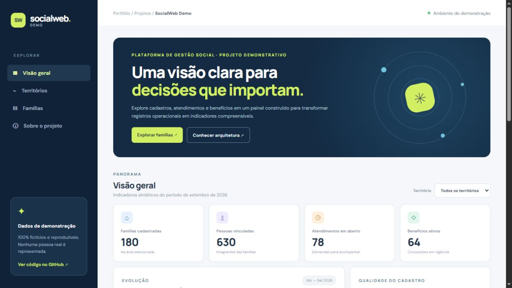
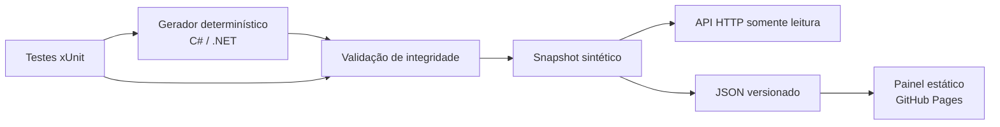

# SocialWeb Demo

**Uma demonstração interativa de gestão social, com dados 100% fictícios.**

[](https://leandroavalle.github.io/socialweb-demo/)
[](https://github.com/LeandroAValle/socialweb-demo/actions/workflows/showcase.yml)



> Projeto de portfólio independente. O SocialWeb Demo **não é o sistema operacional original**, não usa seus dados ou código e não representa um serviço público oficial.

## Em 30 segundos

O painel reúne cadastros familiares, atendimentos e benefícios em três territórios fictícios. É possível trocar o território, buscar uma família por identificador, filtrar a qualidade do cadastro e abrir seus registros. Uma API de leitura expõe a mesma base. Os indicadores são derivados de registros gerados de forma determinística, o que permite conferir os totais e reproduzir o resultado.

**O que este projeto demonstra:** modelagem de domínio, validação de integridade, agregação de indicadores, API HTTP, visualização acessível, documentação técnica, testes e publicação automatizada.

## Explore

| Recurso | Acesso |
| --- | --- |
| Painel interativo | [Abrir demonstração](https://leandroavalle.github.io/socialweb-demo/) |
| API local | `dotnet run --project src/SocialWebDemo.Api` |
| Documentação técnica | [Arquitetura](docs/ARCHITECTURE.md) · [Decisões](docs/DECISIONS.md) · [Dados](docs/DATA.md) · [Segurança](docs/SECURITY.md) |

## Arquitetura



| Camada | Tecnologia | Papel |
| --- | --- | --- |
| Domínio | C# / .NET 10 | Entidades, geração sintética, regras e agregações |
| API | ASP.NET Core Minimal API | Consulta de contexto, indicadores e famílias |
| Interface | HTML, CSS e JavaScript | Exploração responsiva sem dependências de build |
| Qualidade | xUnit e GitHub Actions | Integridade, reconciliação e publicação |

O produto privado que inspirou o **tema** foi criado em ASP.NET MVC/.NET Framework. Esta demonstração é uma implementação nova em .NET 10; não é uma migração daquele sistema.

## Execute localmente

Requisito: [.NET SDK 10](https://dotnet.microsoft.com/download/dotnet/10.0).

```bash
dotnet test SocialWebDemo.slnx -c Release
dotnet run --project src/SocialWebDemo.Api -- --export-snapshot
dotnet run --project src/SocialWebDemo.Api
```

Abra a URL exibida pelo ASP.NET Core e consulte, por exemplo:

```text
GET /health
GET /api/v1/context
GET /api/v1/overview
GET /api/v1/overview?territory=Território%20Aurora
GET /api/v1/households
GET /api/v1/households/FAM-0001
```

Para abrir a interface local, sirva a pasta `site/` por HTTP (por exemplo, `python -m http.server 8000 --directory site`) e acesse `http://localhost:8000`. Abrir o HTML diretamente como arquivo pode bloquear a leitura do JSON no navegador.

## Decisões que importam

1. **Dados sintéticos por padrão.** A semente fixa torna a demonstração reproduzível e impede a exposição de cadastros reais.
2. **Indicadores calculados a partir dos registros.** Totais por território reconciliam com o consolidado. Qualidade cadastral é a razão entre famílias com cadastro completo e famílias selecionadas.
3. **API somente leitura.** O projeto explica consultas e regras sem simular alterações operacionais ou concessões reais.
4. **Frontend estático.** O mesmo snapshot alimenta a interface no GitHub Pages, sem backend hospedado, credenciais ou custos de infraestrutura.
5. **Escopo explícito.** Os números, faixas de renda e estados são ilustrativos; não orientam elegibilidade, política pública ou decisões sobre pessoas.

Veja [as alternativas e consequências](docs/DECISIONS.md) e o [dicionário de dados](docs/DATA.md).

## Verificação

O workflow executa `dotnet test`, compila a API, gera novamente o snapshot e verifica se o arquivo versionado está sincronizado. Na branch `main`, publica `site/` no GitHub Pages. Os testes cobrem geração determinística, reconciliação territorial e rejeição de referências órfãs.

## Autor

**Leandro Valle** — desenvolvimento full stack, integrações e engenharia de dados. [Perfil GitHub](https://github.com/LeandroAValle).
